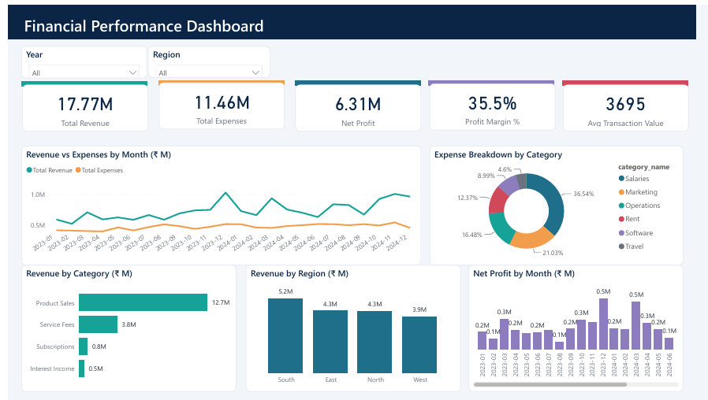
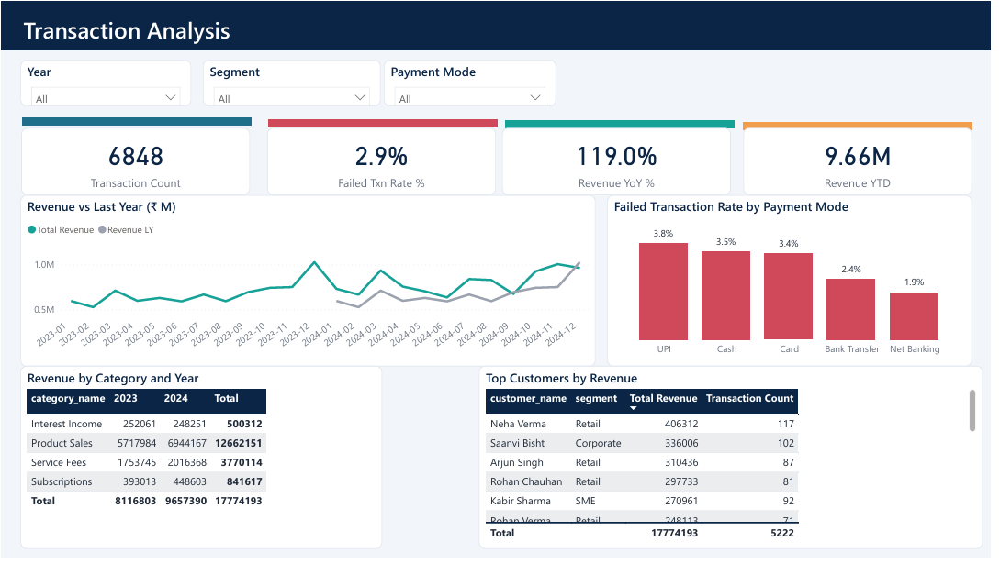
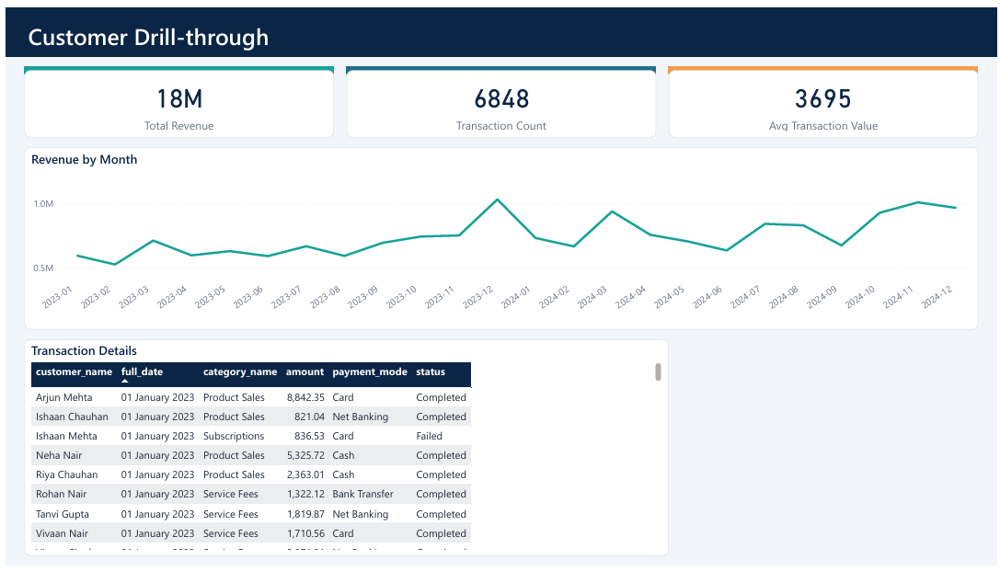
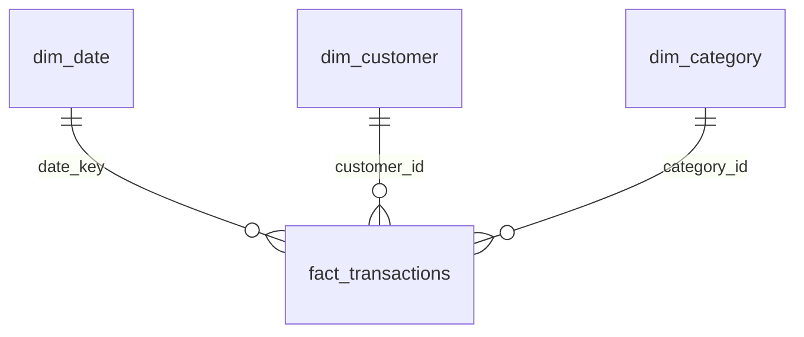

# Financial Analysis Dashboard | Power BI + SQL


An interactive 3-page Power BI dashboard built on a MySQL star schema. It tracks **5 core financial KPIs** across transactions and revenue using **12 custom DAX measures**, with slicers, drill-down and drill-through reports. A small Python module adds an **AI-generated executive summary** whose numbers are validated against the data before it is shown.

> **Note:** The dataset is synthetic (about 6.8K transactions, 2023-2024, 200 customers) and was generated with `scripts/generate_data.py`. It is built for demonstration, not real company data.

---

## Dashboard Preview

### 1. Executive Overview


### 2. Transaction Analysis


### 3. Customer Drill-through


---

## Key KPIs

| KPI | Definition |
|---|---|
| Total Revenue | Sum of completed revenue transactions |
| Total Expenses | Sum of completed expense transactions |
| Net Profit | Revenue - Expenses |
| Profit Margin % | Net Profit / Revenue |
| Avg Transaction Value | Mean value of completed revenue transactions |

## What the Data Shows (FY 2023-24)

- Total revenue is about **₹1.78 crore** against expenses of about **₹1.15 crore**, giving a net profit of about **₹63 lakh** (**35.5% margin**).
- Revenue grew about **19% year over year** (2023 to 2024).
- **Product Sales** is the largest revenue source at about 71% of revenue, followed by Service Fees at about 21%.
- **Salaries** are the biggest cost at about 36% of expenses, followed by Marketing at about 21%.
- The **South** region contributes the most revenue (about 29%).

## Dashboard Features

- **3 report pages** with 20+ visuals: KPI cards, line, bar, column and donut charts, matrix and tables
- **Slicers** for Year, Region, Segment and Payment Mode
- **Drill-down** in the Category x Year matrix
- **Drill-through** from the Top Customers table to a customer-level detail page
- Time intelligence: YoY %, MoM %, YTD and Last Year comparisons

## DAX Measures (12)

| Measure | Purpose |
|---|---|
| Total Revenue | Completed revenue |
| Total Expenses | Completed expenses |
| Net Profit | Revenue - Expenses |
| Profit Margin % | Net Profit / Revenue |
| Avg Transaction Value | Average revenue transaction |
| Transaction Count | Number of transactions |
| Failed Txn Rate % | Failed transactions / all transactions |
| Revenue LY | Same period last year |
| Revenue YoY % | Year-over-year growth |
| Revenue MoM % | Month-over-month growth |
| Revenue YTD | Year-to-date revenue |
| Revenue Share % | Category share of total revenue |

Full definitions are in [`powerbi/measures.dax`](powerbi/measures.dax).

## Data Model



Power BI reads a flattened view, `vw_transactions`, which joins the fact table with all three dimensions. It is related to the `Date` table on `full_date`.

## Tech Stack

Power BI Desktop, DAX, MySQL 8, SQL (views and window functions), Python (pandas, requests, pytest), Gemini API (optional), GitHub Actions (CI)

## Project Structure

```
data/          Generated CSVs (dim_date, dim_customer, dim_category, fact_transactions)
sql/           Schema, data load, reporting views, analysis queries
powerbi/       Financial_Analysis.pbix, measures.dax, FinTheme.json, BUILD_GUIDE.md
ai_insights/   AI executive summary (facts, summarizer, validator, CLI)
tests/         pytest unit tests
.github/       CI workflow
scripts/       generate_data.py
screenshots/   Dashboard images used in this README
```

## How to Run

1. **Generate data** (optional, CSVs are already included)
   ```bash
   python scripts/generate_data.py
   ```
2. **Create the database and load data**
   ```bash
   mysql -u root -p --local-infile=1 < sql/01_schema.sql
   mysql -u root -p --local-infile=1 financial_analysis < sql/02_load_data.sql
   mysql -u root -p financial_analysis < sql/03_views.sql
   ```
   On Windows PowerShell, use `Get-Content sql\01_schema.sql | mysql -u root -p` instead of `<`.
3. **Open the dashboard**
   - Install the MySQL Connector/NET (needed by Power BI)
   - Open `powerbi/Financial_Analysis.pbix` in Power BI Desktop
   - Update the data source to your MySQL server if prompted, then click **Refresh**

## SQL Analysis

[`sql/04_analysis_queries.sql`](sql/04_analysis_queries.sql) contains reusable queries for month-over-month growth, top customers, failed transaction rate by payment mode, and expense share by category.

## AI Executive Summary (`ai_insights/`)

Turns the dashboard's KPIs into a plain-English summary for managers.

```
MySQL / CSV -> verified facts (pandas) -> LLM drafts summary -> validator checks every number -> output
                                                       \-> if invalid or LLM unavailable: safe template summary
```

- **Facts first:** KPIs are computed in code from completed transactions (same logic as the DAX measures). The LLM only sees these verified figures.
- **Validate AI output:** every number in the AI text must match a verified fact (rounding-aware). Invented figures are rejected and a deterministic template summary is used instead, so unvalidated AI text is never shown.
- **Works without any API key.** Add a free Gemini key in `.env` to enable the LLM draft (model is configurable via `GEMINI_MODEL`).
- **Limits:** it validates *numbers*, not the reasoning around them (for example "grew" vs "fell"), so the prompt forbids causes and forecasts.

```bash
pip install -r requirements.txt
python -m ai_insights.run                 # reads data/*.csv
python -m ai_insights.run --source mysql  # reads vw_transactions (set MYSQL_* in .env)
```

Sample output (`ai_insights/output/executive_summary.md`):

> Between 2023 and 2024, the business earned ₹1.78 crore in revenue against ₹1.15 crore in expenses, leaving a net profit of ₹63.13 lakh (35.5% margin). Revenue grew 19.0% in 2024 compared with 2023. Product Sales is the largest revenue source (71.2%), and the South region contributes the most (29.2%). Salaries is the biggest cost at 36.5% of expenses. Revenue peaked in 2023-12 and was lowest in 2023-02.

## Engineering Practices

- **Unit tests (pytest):** KPI maths on a small known dataset, a reconciliation test against the full dataset, validator accept/reject cases, and failure handling (LLM timeout, hallucinated numbers).
- **CI:** GitHub Actions runs the tests and a CLI smoke test on every push.
- **Secure by default:** API keys and DB passwords come from environment variables, `.env` is git-ignored, and the DB user only needs `SELECT`.
- **AI-assisted development:** built with an AI coding assistant. The assistant's output was checked with tests, and the tests caught a real bug (a number-parsing regex that read "2024," as a number).

## Author

**Milan**, B.Tech Electrical Engineering, NIT Hamirpur
